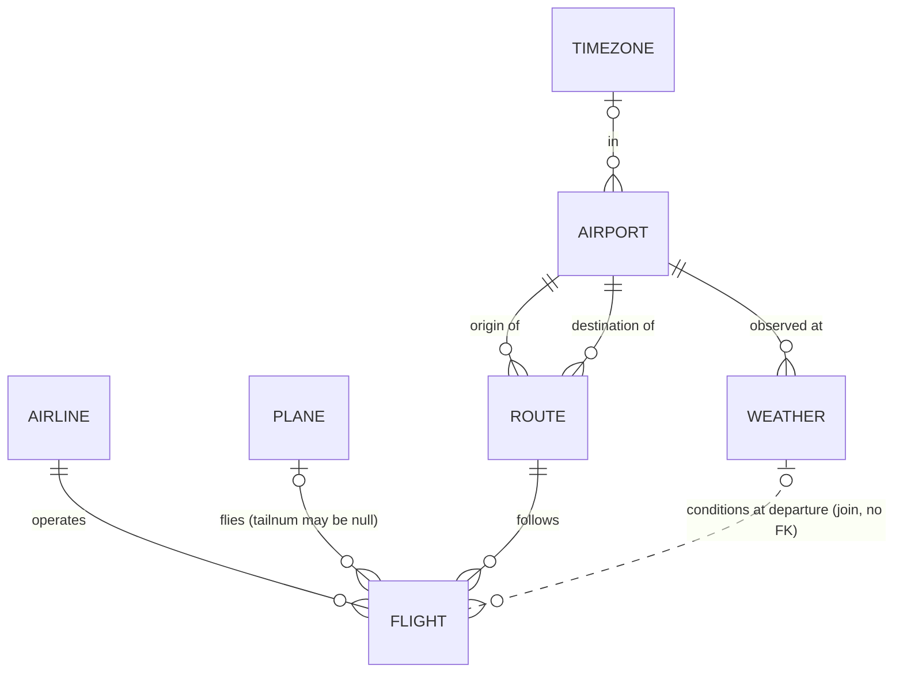

# NYCFlights — design

**Question.** What makes a flight out of New York late: the airline, the time of day, the season, the weather, the plane, or the plane's earlier flights?

**Data.** Every departure from JFK, LGA and EWR in 2013 (US Department of Transportation), as packaged in the *nycflights13* dataset. It comes as 5 CSVs: 336,776 flights, 26,115 hourly weather readings, 3,322 planes, 1,458 airports and 16 airlines. The files are in `data/` and loading them takes about 80 seconds.

**Why a DBMS.** The five files only become useful once they are joined: flight → weather by (airport, hour), flight → plane by tail number, flight → airport by code. The loader found that the joins don't line up perfectly (§5). Without keys and constraints, those mismatches would silently drop or duplicate rows.

## 1. Entities and relationships



`WEATHER` is a weak entity of `AIRPORT`: its key `(origin, time_hour)` borrows the airport's key.

## 2. Relational schema (7 tables, all BCNF)

| Table | Key | Rows | Notes |
|---|---|---:|---|
| timezone(tzone, utc_offset) | tzone | 9 | split out of airport (§3) |
| airport(faa, name, lat, lon, alt_ft, dst, tzone→timezone, in_source) | faa | 1,462 | 4 placeholders |
| airline(carrier, name) | carrier | 16 | name is also a candidate key |
| plane(tailnum, year_built, type, manufacturer, model, engines, seats, speed, engine, in_source) | tailnum | 4,043 | 721 placeholders |
| route(origin→airport, dest→airport, distance_mi) | (origin, dest) | 224 | split out of flight (§3) |
| weather(origin→airport, time_hour, temp_f, …, visib_mi) | (origin, time_hour) | 26,115 | |
| flight(flight_id, flight_date, carrier→airline, flight_no, tailnum→plane, (origin, dest)→route, times, delays, time_hour, status) | flight_id | 336,776 | candidate key (carrier, flight_no, origin, flight_date) |

DDL: `02_ddl.sql`. Constraints include 20 CHECKs (for example `sched_dep_time BETWEEN 0 AND 2359`, `humid BETWEEN 0 AND 100`, `origin <> dest`, and "a cancelled flight has no delay"). All 336,776 source rows pass them.

## 3. Normalization: functional dependencies tested against the data

Each candidate FD was tested with a GROUP BY that counts how many distinct right-hand sides each left-hand side has, for example:

```sql
SELECT tzone FROM airport_raw GROUP BY tzone HAVING COUNT(DISTINCT tz) > 1;   -- 0 rows → FD holds
```

| Candidate FD | In the data | Decision |
|---|---|---|
| tzone → utc_offset | holds (9 of 9) | **decompose** to `timezone`; airport keeps tzone. Removes the transitive dependency faa → tzone → utc_offset. |
| tzone → dst | fails for 7 of 9 tzones | dst stays on airport (it varies by airport, e.g. Arizona) |
| (origin, dest) → distance | holds for 222 of 224 routes; the other 2 differ by 1 mile | **decompose** to `route` (decision D4) |
| (year, month, day) → flight_date, sched_dep_time → (hour, minute) | holds (derived columns) | **drop** year, month, day, hour and minute from flight |
| (manufacturer, model) → seats, engines, … | fails for 2 of 147 models | **no** `aircraft_model` table. An FD is a business rule, and this data says the rule isn't true. |

After these steps, the left-hand side of every non-trivial FD in each table is a superkey, so all seven tables are in BCNF.

## 4. Logic (`03_logic.sql`)

* **Trigger `trg_flight_status`** (BEFORE INSERT OR UPDATE) sets `status` to Cancelled when there is no departure time, Diverted when there is no arrival delay, Delayed when the flight arrived more than 15 minutes late (the DOT rule), and On time otherwise. Because the database derives it, `status` can never disagree with the times. The loader's COPY goes through the trigger: 249,716 on time, 77,630 delayed, 8,255 cancelled, 1,175 diverted.
* **Views:** `v_flight_detail` (one wide row per flight with airline, distance, plane age and weather) and `v_carrier_scorecard`.
* **Function:** `carrier_report(month)` returns the scorecard for one month.

## 5. Data issues and decisions (`04_load.py`)

| # | Issue | Decision |
|---|---|---|
| D1 | 4 destinations (BQN, PSE, SJU, STT, all Puerto Rico / US Virgin Islands) are not in airports.csv | placeholder rows with `in_source = FALSE` keep the FK intact |
| D2 | 721 tail numbers on 50,094 flights are not in planes.csv (Envoy 25k, American 22k: these airlines report fleet numbers) | placeholder planes with `in_source = FALSE`; left out of the plane-age analysis |
| D3 | 3 airports have no tzone | filled from the UTC offset, which matches exactly one tzone in the file (−5 → New_York, −9 → Anchorage) |
| D4 | EWR–EGE and JFK–EGE each have two distances, 1 mile apart | keep the more common distance (95 flights adjusted) |
| D5 | 1,556 flights have no weather row for their hour | no FK from flight to weather; weather analyses use an inner join |

## 6. Queries and relational algebra

`05_queries.sql` asks one question per suspect: Q1 airline (view plus RANK), Q2 hour, Q3 month, Q4 weather (join on a composite key), Q5 plane age, Q6 worst routes (3-way join, HAVING, RANK), Q7 knock-on delays (LAG window by plane and day, CORR), Q8 time made up in the air.

Q4 in relational algebra, where F = flight and W = weather:

  γ visibility, precip; AVG(dep_delay) ( F ⋈ F.origin = W.origin ∧ F.time_hour = W.time_hour W )

Q6, restricted to routes flown 365+ times:

  σ n ≥ 365 ( γ origin, dest; COUNT(*)→n, AVG(arr_delay) ( F ⋈ ROUTE ⋈ dest = faa AIRPORT ) )

## 7. Index demo (`06_demo.sql`, rolled back)

Looking up one plane (`tailnum = 'N725MQ'`, 575 flights): without an index, PostgreSQL runs a parallel sequential scan that reads **3,840** buffers. After `CREATE INDEX idx_flight_tailnum`, a bitmap index scan reads **571**. The demo also cancels a flight to show the trigger firing, and inserts three bad rows (unknown airline, unknown route, a 25:75 departure time) that the FK and CHECK constraints reject.

## 8. Findings (notebook `analytics/nycflights_analysis.ipynb`)

See `analytics/readings.md`. In brief: a late plane stays late (r = 0.375; 84 min after a 60+ min late previous leg), and delays snowball through the day (1.6 min at 6 am, 24.8 min at 7 pm). Rain triples the delay (11 → 33 min). Airlines differ by 16 points on on-time rate. Plane age has no clear effect.

## 9. 20-minute split

| Member | Part | Minutes |
|---|---|---:|
| 1 | Question, data, why a DBMS, ER diagram | 4 |
| 2 | Schema, FDs tested in SQL, BCNF decisions, data issues D1–D5 | 5 |
| 3 | Trigger, views, queries Q1–Q8, live demo (index, trigger, constraints) | 6 |
| 4 | Analysis: charts, regression, findings, limits | 5 |

## 10. Run it

```powershell
powershell -ExecutionPolicy Bypass -File run_all.ps1      # DB + load + queries/demo → results\ (~1.5 min)
.venv\Scripts\python analytics\build_notebook.py           # notebook + figures (~1 min)
```
